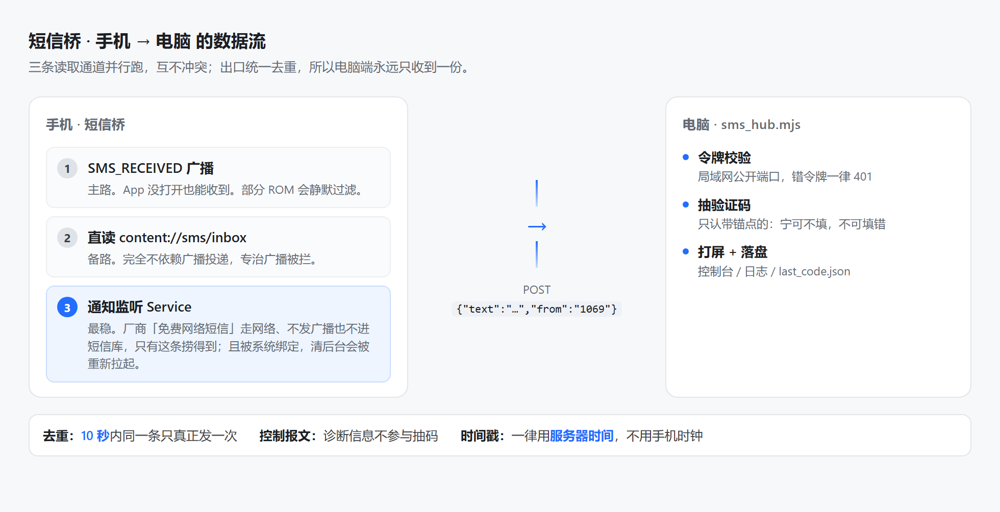
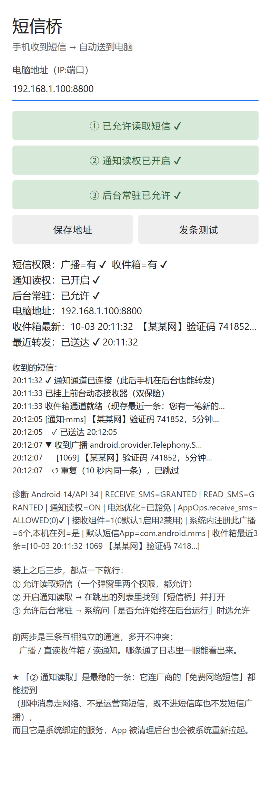

# 短信桥 (android-smsbridge)

**手机收到的短信和通知，自动送到电脑上** —— 一个 300 行的 Android App + 一个零依赖的 Node 收码服务。用来给任何需要手机验证码的自动化流程供码，人不用盯着手机。

<p align="center">
  
</p>

## 为什么不直接用现成的

SmsForwarder 这类工具功能很全，但正因为它全，配置面就大：发送通道、转发规则、匹配条件、正则、模板占位符……而实际需求往往只是「收到短信就原样发给我的电脑」。

所以这里做了**刻意的减法**：

| | 成熟转发工具 | 短信桥 |
|---|---|---|
| 概念层次 | 通道 + 规则两层 | 一层：收到就发 |
| 过滤条件 | 正则 / 关键词 / 模板 | 无，原文照发 |
| 判断逻辑 | 手机上判 | **都放电脑端** |
| 令牌 | 界面上填 | 编译时烤进包，不用填 |
| 要配的东西 | 一堆 | 一个地址（换网络时才改） |

**「手机上越少逻辑，出问题时越好查」** 是贯穿全部代码的一条原则：App 只负责搬原文，抽验证码、过滤、落盘全在电脑端 —— 那边能改代码、能看日志，手机上不能。

## 三条读取通道（核心）

这是这个项目唯一值得单独讲的东西。**同一条短信有三条互相独立的路能捞到**，因为「收不到」这件事在不同手机上有完全不同的原因：

<p align="center">
  
</p>

| 通道 | 覆盖什么 | 什么时候会瞎 |
|---|---|---|
| **① SMS_RECEIVED 广播** | 运营商真短信，App 没打开也能收 | 部分 ROM 静默过滤（权限全绿也收不到） |
| **② 直读 `content://sms/inbox`** | 任何进了短信库的消息 | 只覆盖「真的是 SMS」的消息 |
| **③ 通知监听 Service** | 短信 / 厂商网络短信 / RCS，全都覆盖 | 需要用户在系统设置里手动开一次 |

**为什么非要三条**：国内厂商 ROM 有个很坑的情况 —— 小米/红米的「免费网络短信」走的是网络，**压根不是运营商短信**，既不触发任何短信广播，也不进短信库。三条路一起开，是唯一稳的做法。而通道 ③ 还有个额外好处：它是**被系统绑定的 Service**，进程被清理后系统会重新拉起，不像静态广播那样受「自启动/省电」管控影响。

出口处统一去重（10 秒内同一条只真正发一次），所以电脑端永远只收到一份报文。

### 还有两个容易被忽略的开关

- **忽略电池优化**。手机息屏闲置一段时间后，省电策略恰好挑这种时候把 App 冻掉 —— 通知监听服务被回收、转发静默停止，而现场看什么都正常。这是这类工具在国产 ROM 上的头号死因。
- **启动自检**。有些系统/安全软件会把短信接收组件 `disable` 掉：权限给了、App 活着、测试按钮也能发出去，但短信一条都收不到。App 启动时会检查并重新启用它。

## 快速开始

### 1. 电脑端：起收码服务

```bash
node server/sms_hub.mjs              # 默认监听 8800，令牌自动生成
```

它会把**你该在手机上填的地址**打印出来（自动列出本机局域网 IP）。首次运行会在项目根生成 `.smsbridge_token`。

> Windows 防火墙默认拦入站。手机连不上就先放行端口（管理员）：
> ```
> netsh advfirewall firewall add rule name="smsbridge-hub" dir=in action=allow protocol=TCP localport=8800
> ```

### 2. 手机端：编译并安装

需要两样东西：一个 JDK（要 `javac`/`keytool`），以及 Android SDK 里的 **build-tools** 和 **一个平台的 android.jar**。不装 Android Studio 也行 —— 只下 SDK 命令行工具，然后：

```bash
sdkmanager "build-tools;34.0.0" "platforms;android-34"
```

三个位置按「命令行参数 > 环境变量 > 常见安装位置自动探测」的顺序找，通常探测就够了；探测不到再显式给：

```bash
JAVA_HOME=/path/to/jdk \
ANDROID_BT=/path/to/build-tools/34.0.0 \
ANDROID_JAR=/path/to/platforms/android-34/android.jar \
./build.sh
```

产物是项目根的 `smsbridge.apk`，`adb install` 或直接拷进手机装。

- 想固定电脑地址（省得装完还要在界面上填）：`SMSBRIDGE_HOST=192.168.1.50:8800 ./build.sh`
- 令牌取用顺序：`SMSBRIDGE_TOKEN` 环境变量 > `.smsbridge_token` 文件 > 自动生成。**build.sh 和收码服务用的是同一个文件**，所以两边天然对齐，不用手工同步。
- 签名密钥 `keystore.jks` 首次编译时自动生成，是自签的、口令固定为 `android`，**只够本机侧载**，不构成任何身份保证。它已在 `.gitignore` 里 —— 私钥入库等于别人能签出你 App 的「更新」。

### 3. 手机上点三下

装好后打开 App，按界面上的 ①②③ 各点一次并允许。之后就不用管了。

## 电脑端接的是什么

任何能接 HTTP 的服务都行。报文长这样：

```http
POST /sms?token=<令牌>
Content-Type: application/json

{"text":"【某某网】验证码 741852，5分钟内有效","from":"1069"}
```

也接受纯文本 body、`form-urlencoded`，以及常见的字段别名（`msg`/`content`/`body`、`sender`/`number`/`address`、`ts`/`time`/`timestamp`）。带上 `from` 有额外好处：日志里一眼能看出**是哪条通道**在干活（App 会用 `notif:<包名>` 标注通知通道）。

内置服务另外还提供：

| 路由 | 用途 |
|---|---|
| `POST /sms?token=` | 收短信 |
| `GET /latest?token=` | 读回最近抽到的验证码 |
| `GET /health` | 存活检查 |

### 抽验证码的判据：宁可不填，不可填错

抽错码比不填更糟 —— 很多平台把它计入风控。所以**只认带锚点的码**：

| 输入 | 结果 |
|---|---|
| `验证码 123456` / `您的验证码是654321` / `786543 是您的验证码` | 抽得到 |
| `您的订单 123456 已发货` | **null**（不猜） |
| `手机号 13800138000 已绑定，验证码 556677` | `556677`（不会把手机号当码） |

要接更花的短信格式，把锚点词加进 `server/sms_hub.mjs` 的 `CODE_WORDS` 就行。

另外两条判据也值得说：

- **控制报文不参与抽码**。App 会拿同一个接口上报诊断信息，而诊断里包含「收件箱最近几条」—— 那里面天然带着别处的验证码文本，不挡住就会抽出一个**错的**码。
- **时间戳一律用服务器时间**。手机时钟可能有偏差甚至时区不对，而下游「只认比某个时刻更新的码」这类防旧码判据全靠时间比较，拿手机时间会把它弄坏。手机时间另存在 `deviceTs` 字段里。

## 已知限制

- **只在本机侧载**。没有发布到任何应用商店；`REQUEST_IGNORE_BATTERY_OPTIMIZATIONS` 这类权限也不适合上架（Google Play 对它有品类限制）。
- **明文 HTTP**。目标是局域网内的 `http://192.168.x.x`，所以 manifest 和 `network_security_config.xml` 都放行了 cleartext（两者都写，因为 NSC 会覆盖 manifest 那个属性）。**不要把它暴露到公网。**
- **界面是代码搭的**，没有 layout XML。控件就那么几个，另立一份 XML 不划算。
- **不能用匿名内部类**（`Xxx$1.class`）。手工编译链里 d8 遇到匿名类会内部崩溃（`NullPointerException: Cannot invoke "String.length()"`，build-tools 33 和 34 都复现过）。所有监听器都改成命名类或由外层类实现接口。**改用 gradle 构建就没这条限制。**
- **收码服务是轮询文件的**，不是进程间通信：服务挂了重启不丢状态，下游崩了也不影响服务，还能随时 `cat` 出来人眼核一下。

## 目录

```
├── AndroidManifest.xml          权限与三个组件的声明（每条权限为什么需要，都写在注释里）
├── build.sh                     手工编译链：aapt2 → javac → d8 → zipalign → apksigner
├── src/com/smsbridge/
│   ├── MainActivity.java        界面：三个开关 + 实时流水 + 诊断
│   ├── SmsReceiver.java         通道 ①：短信广播
│   ├── Inbox.java               通道 ②：直读短信库
│   ├── NotifListener.java       通道 ③：通知监听
│   ├── PostTask.java            POST 到电脑 + 跨通道去重 + 地址归一化
│   ├── MsgLog.java              界面流水
│   └── Ticker.java              1.5 秒自刷
├── res/xml/network_security_config.xml
├── server/sms_hub.mjs           电脑端收码服务（零依赖）
├── docs/                        两张图
└── _check/                      图的源文件与截图脚本（改了文案可以重新生成）
```

## License

MIT © 人间小土鸡
